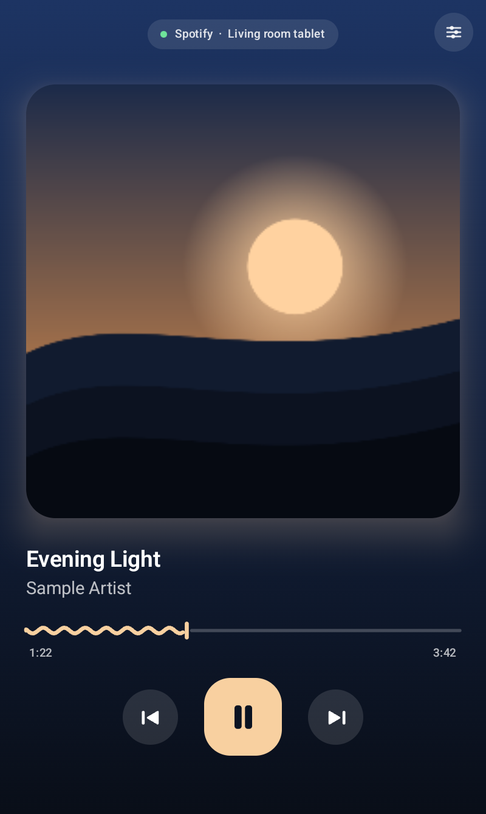
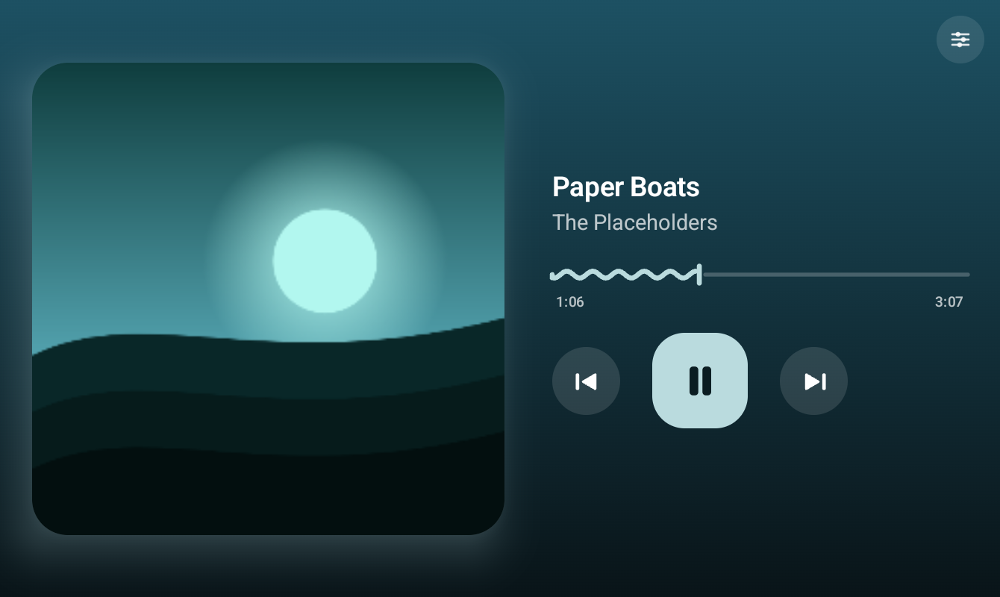
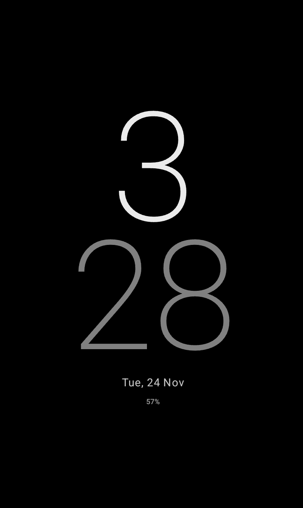
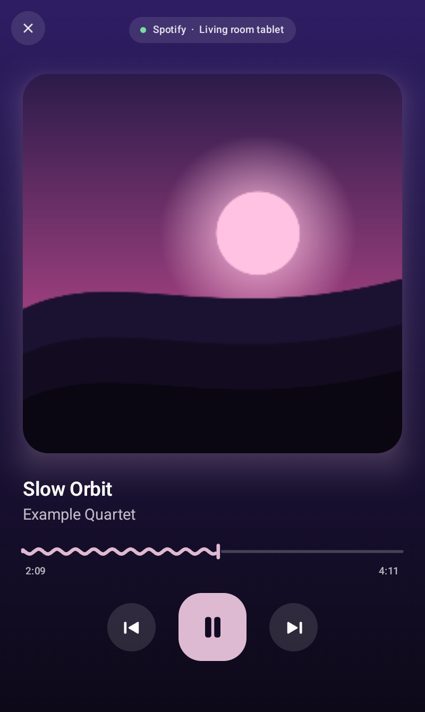
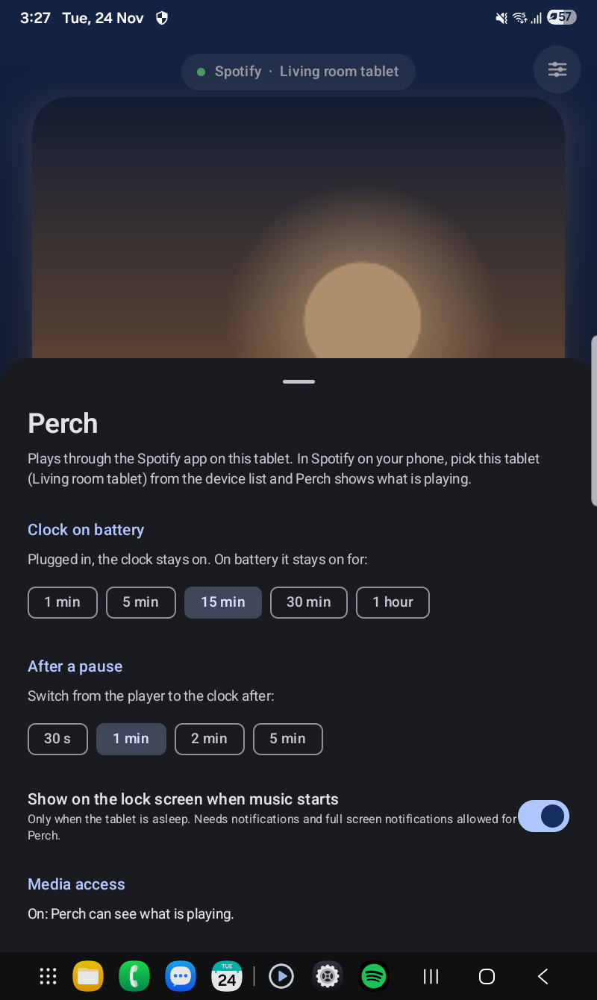
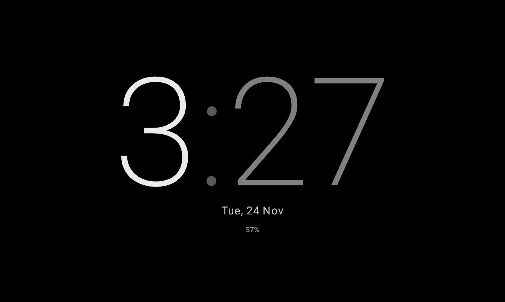

# Perch

**Perch gives a tablet a face as a speaker.** When music plays on the tablet, it shows a clean
now-playing screen: cover art, title, a wavy progress bar and big, spaced-out controls. When nothing
plays it becomes an always-on-display style clock and date, forever while charging and for a time you
choose on battery. It can also run as the tablet's **screen saver**, so the display comes up by itself on the
dock, over the lock screen, with nothing to launch.

Perch does **not** play or decode audio. The tablet's own, official **Spotify app** does that (it shows up as a
Spotify Connect device on your phone, under the tablet's own name). Perch reads what that app is playing and
drives its controls, so there is nothing Spotify-specific to break.

Built with **[Kotlin](https://kotlinlang.org/)** and **Jetpack Compose** (Material 3) for **Android 15+**.

<!-- Replace bash-hike if you fork or rename the repository. -->

---

## Screenshots

| Now playing | Landscape | Clock |
| --- | --- | --- |
|  |  |  |

| Screen saver | Settings | Clock, landscape |
| --- | --- | --- |
|  |  |  |

> Captured on a Galaxy Tab A9 (Android 16) from the debug build's demo session: the cover art is
> generated, and the tracks, artists and the "Living room tablet" name are made up. No copyrighted content.
> See [screenshots/README.md](screenshots/README.md).

---

## Features

- **Now playing** — square cover with a glow in the cover's own colours, title and artist, a Material 3
  Expressive style wavy progress bar (tap or drag to seek), a play button that morphs between a circle and a
  rounded square, and swipe-on-cover for next and previous. Portrait and landscape.
- **Clock** — thin, tall digits stacked in portrait and on one line in landscape, the date and the battery
  level. It dims to a low backlight, a touch brightens it for a few seconds, and it drifts a few pixels each
  minute so one set of pixels does not carry the same shapes all night.
- **Power-aware** — plugged in, the clock stays on forever. On battery it stays on for 1 minute to 1 hour
  (you choose), counted from your last touch; the player always keeps the screen on.
- **Screen saver** — Perch is selectable under Settings > Display > Screen saver. Android starts it when the
  tablet is idle on the charger or dock, including over the lock screen, and it shows the same player and
  clock. A cross leaves it.
- **After a pause** — the player gives way to the clock after 30 seconds to 5 minutes, as you choose.
- **Opens itself** — waking a locked tablet while music plays shows Perch instead of the lock screen, and a song starting while the tablet sleeps or sits on the lock screen wakes the screen and
  shows Perch over it. On by default, never fires while you are using the tablet, and can be switched off.
- **Any player** — works with anything that publishes a media session, not only Spotify.
- **Nothing leaves the device** — no network permission, no analytics, no accounts. See the
  [privacy policy](docs/privacy.md).

---

## Install

**Sideload:** download `perch-vX.Y.Z.apk` from the
[latest release](https://github.com/bash-hike/perch/releases/latest) and install it. Android 15 or newer.

Then, once:

1. Open Perch and tap **Allow media access**, and switch Perch on in the list. This is the one permission Perch
   is built on: Android only lets an app read another app's media session once it has notification access.
   Perch reads no notifications.
2. Settings > Display > **Screen saver** > **Perch** (start while charging).
3. Allow notifications, and switch on "full screen notifications" for Perch, when asked. That is what lets Perch
   open itself over the lock screen when music starts.
4. In Spotify on your phone, pick the tablet from the device list.

Details and troubleshooting: [docs/setup.md](docs/setup.md).

---

## Documentation

| Page | What it covers |
| --- | --- |
| [How it works](docs/how-it-works.md) | Why Perch reads a media session instead of decoding Spotify, the screen saver, and the Android rules behind each choice |
| [Setup](docs/setup.md) | Requirements, first run, opening automatically, battery optimisation |
| [Permissions](docs/permissions.md) | Every permission, why, and which build has it |
| [Privacy policy](docs/privacy.md) | What Perch handles (nothing leaves the device) |
| [Build from source](docs/build.md) | Toolchain, signing, tests, screenshots |

---

## Credits & attribution

Perch's repository layout, documentation style and release workflow are modelled on
**[Rusty](https://github.com/SerafiniJose/rusty)** by SerafiniJose, an Android Spotify Connect receiver built on
librespot. No Rusty code is used. Perch exists because Spotify stopped issuing the audio keys that
librespot-based receivers depend on (see [How it works](docs/how-it-works.md)), and takes the opposite
approach: let the official app play, and build the display around it.

Built with AndroidX, Jetpack Compose, Material 3 and `androidx.palette`.

---

## Disclaimer

Perch is an independent project. It is **not affiliated with, endorsed by or sponsored by Spotify AB**.
"Spotify" is a trademark of Spotify AB; it is named here only to say which app Perch can display.

---

## License

[MIT](LICENSE)
